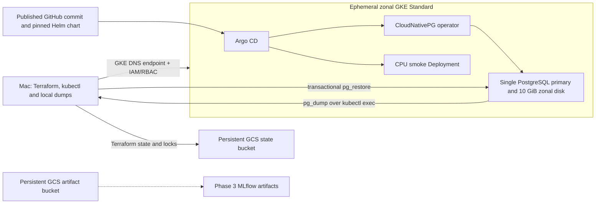

# Platform architecture

## Phases 1 and 2

| Boundary | Owner | Deployment and operation |
| --- | --- | --- |
| Foundation | Terraform foundation root | First apply creates a protected versioned GCS state bucket and one private artifact bucket. Foundation state starts locally and is backed up separately. |
| Lab | Terraform GKE root | Uses a dedicated GCS prefix. Manages the zonal cluster, single CPU pool, VPC, subnet and webhook firewall. |
| Bootstrap | Helm and the lifecycle script | Installs Argo CD once per cluster. Argo CD then reconciles its own main configuration and the platform Applications. |
| GitOps | Argo CD | Bootstrap applies the operator Application first and waits for sync, health, CRD establishment and a working admission webhook before applying PostgreSQL. The CNPG Ready condition gates database health. |
| Database | CNPG and the operator running the lab | CNPG generates the `mlflow-postgres-app` secret for user `mlflow`. The primary's local Unix socket permits maintenance as OS user `postgres`. The scripts never read the application password. |

## Networking and egress

The VPC uses `10.40.0.0/24` for nodes, `10.44.0.0/16` for Pods, `10.45.0.0/20` for Services and a dedicated `10.46.0.0/28` control-plane CIDR. Review overlap with connected networks before adding connectivity. The shared default VPC has broad ingress rules, and its Frankfurt subnet had no secondary ranges or Private Google Access at preflight. The lab leaves it untouched.

The cluster defaults to private nodes and has Private Google Access on its subnet. The first full GitOps deployment explicitly opts into a temporary public node IP. Argo CD's repo server needs GitHub and the upstream CNPG chart endpoint. Nodes must pull from GHCR, Quay, Docker Hub and Google Artifact Registry as required by rendered charts. A public IP provides egress without adding internet ingress rules. If organization policy denies it, stop before provisioning and review an approved ephemeral NAT or existing egress path that covers both nodes and Pods. An Artifact Registry mirror alone leaves GitHub unresolved.

Only the DNS-based Kubernetes API endpoint is enabled. Access requires Google IAM and Kubernetes permissions. Dataplane V2 supports Kubernetes NetworkPolicy. The custom TCP 9443 VPC rule allows the control plane to reach CNPG admission on tagged nodes. Confirm the actual control-plane CIDR and webhook dry run during first deployment. Argo CD uses ClusterIP and local port forwarding. PostgreSQL uses internal CNPG Services.

## CPU lab sizing

The pinned Argo CD chart disables Dex and notifications for this exercise. Argo CD, its Redis initialization Job, the CNPG operator, PostgreSQL and the smoke Deployment declare CPU and memory requests. The steady-state lab workload requests 925 mCPU and 1,440 MiB. The Redis hook adds 50 mCPU and 32 MiB during bootstrap. An `e2-standard-2` has 2 vCPUs and 8 GiB. For the GKE 1.36 baseline, estimate 1,930 mCPU and roughly 6.1 GiB allocatable before GKE system Pods and DaemonSets. Verify actual allocatable resources, requested resources and available disk with `kubectl describe node` before adding workloads. The request budget indicates feasibility for the lab. Peak utilization, node upgrades and ephemeral image storage still require validation. [GKE node sizing](https://docs.cloud.google.com/kubernetes-engine/docs/concepts/plan-node-sizes).

## Security and recovery

Trust the reviewed GitHub commit, chart versions and pinned images. Helm-installed controllers have cluster privileges and must be treated as supply-chain dependencies. Explicitly authorize Kubernetes operators who can change Applications, Secrets or use `pods/exec`. Broad Argo CD default project permissions are acceptable only in the dedicated single-operator lab. Restrict source repositories and destination permissions with an AppProject before adding tenants.

DB credentials are generated per cluster and live in Kubernetes Secrets. Future MLflow should read its own Secret with scoped RBAC, and access only its artifact bucket through a dedicated Workload Identity principal without a service account key. Use SOPS for reviewed encrypted Git configuration or External Secrets Operator with Secret Manager when operational requirements justify it. Keep dump files under a `0700` directory on an encrypted Mac volume with `0600` files. The archives contain plaintext application data inside compressed PostgreSQL custom format. Only restore trusted archives. Credential material, kubeconfig, state, saved plans and dumps stay outside version control.

Loss of the single node, primary, zone or local archive can interrupt the lab or lose data. Logical dumps provide recovery to the last successful backup. They exclude role credentials, global privileges, WAL and GCS artifacts. The workflow assumes one active administrator and no privileged sessions writing through the maintenance connection gate.
